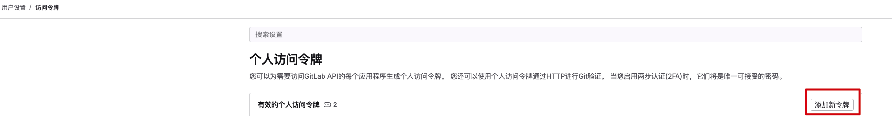
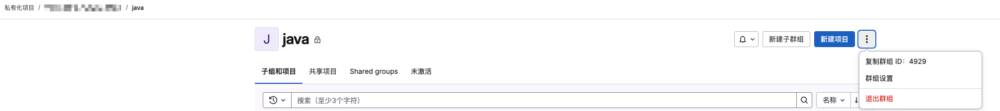
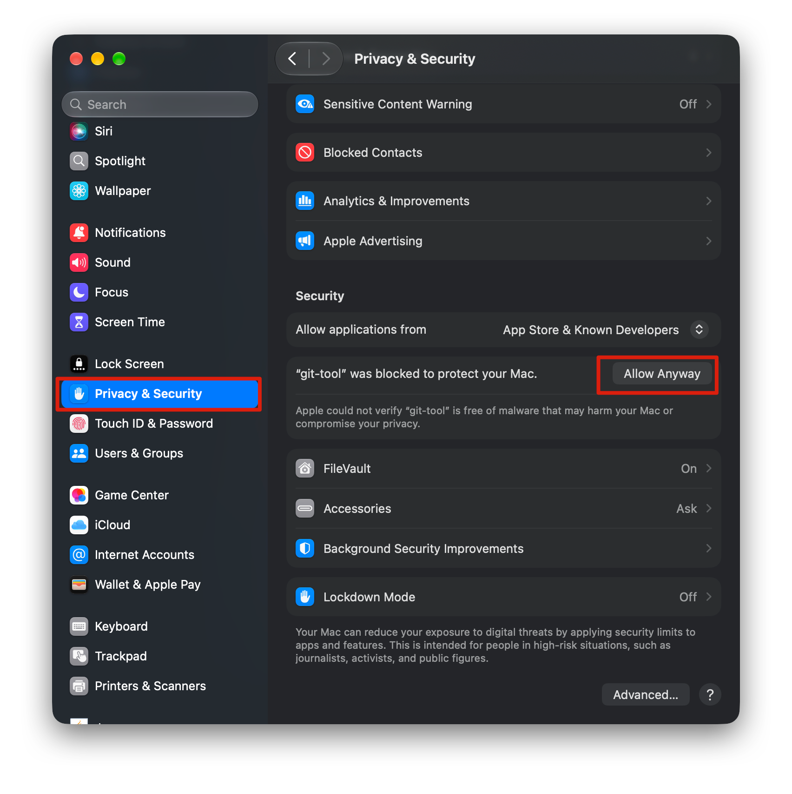
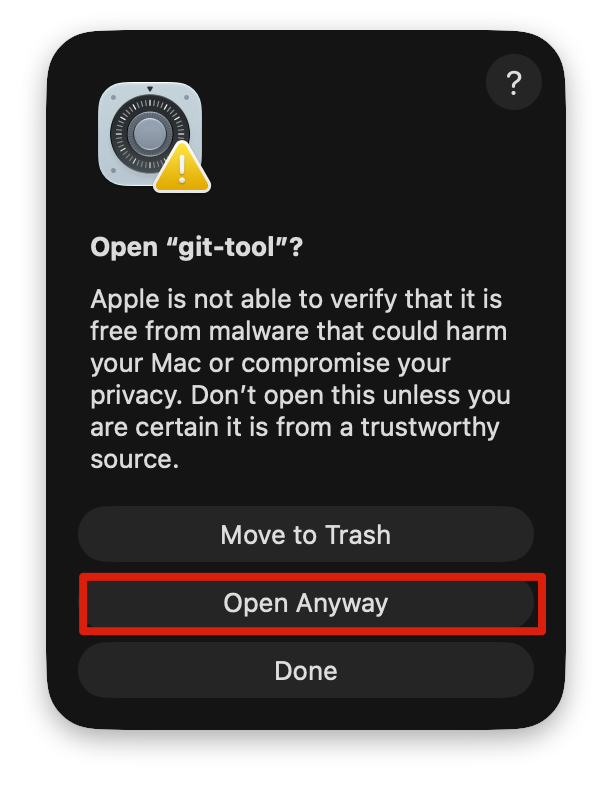

# git-tool 使用说明

`git-tool` 用于批量管理 GitLab 项目组下的 Git 仓库，支持：

- `init`：按项目组批量克隆仓库
- `pull`：批量拉取指定分支
- `checkout`：批量切换分支

配置文件支持按 `[分组名]` 划分工作和个人身份，通过 `-p/--profile` 一键切换。

## 一、安装

### 方式 1：下载发布包

从 GitHub Releases 下载对应平台的压缩包，解压后直接运行 `git-tool`。

### 方式 2：从源码构建

```bash
cargo build --release
```

构建产物：

- macOS / Linux：`target/release/git-tool`
- Windows：`target\release\git-tool.exe`

## 二、配置

### 1. 创建配置文件

复制仓库中的示例文件到用户主目录：

```bash
cp .git-tool-env.example ~/.git-tool-env
chmod 600 ~/.git-tool-env
```

也可以通过 `-e/--env-file` 指定其他位置。

### 2. 分组配置文件示例

```ini
# 顶层共享配置：所有分组都可以使用
# GITLAB_COMMIT_USER_NAME=<author_name>
# GITLAB_COMMIT_USER_EMAIL=<author@example.com>

[work]
GITLAB_BASE_URL=https://gitlab.example.com
GITLAB_ACCESS_TOKEN=<your_work_gitlab_access_token>
GITLAB_COMMIT_USER_NAME=<work_author_name>
GITLAB_COMMIT_USER_EMAIL=<work_author@example.com>

[personal]
GITLAB_BASE_URL=https://gitlab.com
GITLAB_ACCESS_TOKEN=<your_personal_gitlab_access_token>
GITLAB_COMMIT_USER_NAME=<personal_author_name>
GITLAB_COMMIT_USER_EMAIL=<personal_author@example.com>
```

说明：

- `[work]`、`[personal]` 是分组名，可以自行增加或改名。
- 分组内没有的配置项会回退到顶层共享配置。
- 同名配置以分组内的值为准。
- 配置文件支持 `#` 整行注释和 `export KEY=VALUE` 写法。
- 项目组 ID 不写入配置文件：每次 `init` 的目标组可能不同，需通过 `-g` 实时指定。

### 3. 配置项说明

| 配置项 | 是否必填 | 说明 |
| --- | --- | --- |
| `GITLAB_BASE_URL` | 必填 | GitLab 实例地址，结尾不要带 `/` |
| `GITLAB_ACCESS_TOKEN` | 必填 | GitLab 个人访问令牌，建议只授予 `read_api` 权限 |
| `GITLAB_COMMIT_USER_NAME` | 可选 | 克隆成功后写入仓库本地配置的提交作者名，也可用同名环境变量设置 |
| `GITLAB_COMMIT_USER_EMAIL` | 可选 | 克隆成功后写入仓库本地配置的提交邮箱，也可用同名环境变量设置 |

`GITLAB_COMMIT_USER_NAME` 和 `GITLAB_COMMIT_USER_EMAIL` 只会写入新克隆仓库的
`.git/config`，不会修改全局 Git 配置。只配置其中一项时，仅设置该项。它们没有
对应的命令行参数，优先级为：环境变量 > 当前分组 > 顶层共享配置。

### 4. 选择分组

```bash
# 使用 work 分组，组 ID 按本次目标实时指定
git-tool init -p work -g 123

# 使用 personal 分组
git-tool init -p personal -g 456
```

也可以通过环境变量指定分组，适合脚本或 CI：

```bash
GIT_TOOL_PROFILE=work git-tool init -g 123
```

如果配置文件中只有一个分组，可以省略 `-p`，程序会自动使用该分组。
存在多个分组且没有指定时，程序会在缺少配置项时提示可用分组。

### 5. 配置优先级

对于 `GITLAB_BASE_URL`、`GITLAB_ACCESS_TOKEN`：

```text
命令行参数 > 进程环境变量 > 当前分组 > 顶层共享配置
```

对应的命令行参数和变量：

| 配置项 | 命令行参数 | 环境变量 |
| --- | --- | --- |
| `GITLAB_BASE_URL` | `-l/--gitlab_base` | `GITLAB_BASE_URL` |
| `GITLAB_ACCESS_TOKEN` | `-k/--gitlab_access_token` | `GITLAB_ACCESS_TOKEN` |
| 分组选择 | `-p/--profile` | `GIT_TOOL_PROFILE` |

项目组 ID 只能通过 `-g/--gitlab_repo_group` 传入，不读取环境变量或配置文件，
避免误用上一次 `init` 的组。推荐把地址和令牌放在配置文件中，命令行只保留
`-p` 和 `-g`，避免令牌进入 shell 历史和进程列表。

### 6. 配置 GitLab SSH 密钥（Windows / macOS）

`init` 通过 SSH 地址克隆仓库，首次使用前需要把本机公钥添加到 GitLab。
SSH 密钥用于克隆代码，访问令牌用于调用 GitLab API，两者都需要配置。

#### macOS

1. 生成密钥（邮箱替换为你的 GitLab 邮箱，一路回车使用默认路径）：
   ```bash
   ssh-keygen -t ed25519 -C "<你的邮箱>"
   ```
2. 复制公钥：
   ```bash
   pbcopy < ~/.ssh/id_ed25519.pub
   ```
3. 打开 GitLab，点击右上角头像 → **编辑个人资料 / Edit profile** → **SSH 密钥 / SSH Keys**
   → **添加新密钥 / Add new key**，粘贴公钥后保存。
4. 验证：
   ```bash
   ssh -T git@<你的GitLab域名>
   ```
   出现 `Welcome to GitLab, @username!` 表示配置成功。

#### Windows

1. 在 PowerShell 中生成密钥（Windows 10/11 通常已自带 OpenSSH）：
   ```powershell
   ssh-keygen -t ed25519 -C "<你的邮箱>"
   ```
   默认保存到 `C:\Users\<用户名>\.ssh\id_ed25519`。
2. 复制公钥：
   ```powershell
   Get-Content $env:USERPROFILE\.ssh\id_ed25519.pub | Set-Clipboard
   ```
3. 在 GitLab 中按上面的路径添加 SSH 密钥。
4. 验证：
   ```powershell
   ssh -T git@<你的GitLab域名>
   ```

> 只上传 `.pub` 公钥，不要泄露没有 `.pub` 后缀的私钥。
> 如果提示 `ssh-keygen` 不存在，在“设置 → 应用 → 可选功能”中安装“OpenSSH 客户端”。

### 7. 生成 GitLab 访问令牌

1. 打开 `https://<你的 GitLab 地址>/-/user_settings/personal_access_tokens`
2. 点击“添加新令牌”
3. 至少勾选 `read_api` 权限
4. 创建后立即复制令牌

> 令牌只在创建后显示一次，刷新页面后无法再次复制。



### 8. 获取项目组 ID

进入目标项目组页面，复制项目组 ID：



> 组 ID 只用于 `init`，每次克隆不同项目组时通过 `-g` 传入；
> `pull` 和 `checkout` 只操作本地目录，不需要组 ID。

## 三、命令与参数

查看总帮助：

```bash
git-tool -h
```

查看子命令帮助：

```bash
git-tool init -h
git-tool pull -h
git-tool checkout -h
```

### 全局参数

| 参数 | 说明 |
| --- | --- |
| `-L, --lang <zh\|en>` | 界面语言，默认根据系统环境自动检测 |
| `-h, --help` | 查看帮助 |
| `-V, --version` | 查看版本 |

### init：批量克隆仓库

`init` 使用 SSH 地址克隆，首次使用请先完成“二、6 配置 GitLab SSH 密钥”。

```bash
git-tool init -p work -g 123
```

| 参数 | 默认值 | 说明 |
| --- | --- | --- |
| `-p, --profile <名称>` | 自动 | 使用的配置分组 |
| `-l, --gitlab_base <地址>` | 配置文件 | GitLab 实例地址 |
| `-g, --gitlab_repo_group <组ID>` | 必填 | GitLab 项目组 ID，每次 `init` 手动指定 |
| `-k, --gitlab_access_token <令牌>` | 配置文件 | 个人访问令牌 |
| `-e, --env-file <路径>` | `~/.git-tool-env` | 配置文件路径 |
| `-d, --directory <目录>` | `.` | 仓库克隆到的父目录 |
| `-b, --branches <分支>` | `master` | 克隆后要切换的分支，多个用英文逗号分隔 |

示例：

```bash
# 使用 work 分组，克隆到 ~/work-projects
git-tool init -p work -g 123 -d ~/work-projects

# 克隆后依次切换到 master 和 develop
git-tool init -p work -g 123 -b master,develop

# 使用其他配置文件
git-tool init -p personal -g 456 -e /path/to/my-config
```

### pull：批量拉取分支

在指定目录的一级子目录中查找 Git 仓库，依次切换并拉取目标分支。

```bash
git-tool pull -d ~/work-projects -b master
```

| 参数 | 默认值 | 说明 |
| --- | --- | --- |
| `-d, --directory <目录>` | `.` | 仓库所在的父目录 |
| `-b, --branches <分支>` | `master` | 要拉取的分支，多个用英文逗号分隔 |

### checkout：批量切换分支

```bash
git-tool checkout -d ~/work-projects -b develop
```

| 参数 | 默认值 | 说明 |
| --- | --- | --- |
| `-d, --directory <目录>` | `.` | 仓库所在的父目录 |
| `-b, --branches <分支>` | `master` | 要切换的分支，多个用英文逗号分隔 |

## 四、推荐使用流程

1. 按“二、6”配置 GitLab SSH 密钥。
2. 在 `~/.git-tool-env` 中配置好 `work` 和 `personal` 两个分组。
3. 克隆公司项目：

   ```bash
   git-tool init -p work -g 123 -d ~/work-projects
   ```

4. 日常更新公司项目：

   ```bash
   git-tool pull -d ~/work-projects -b master
   ```

5. 需要切换分支时：

   ```bash
   git-tool checkout -d ~/work-projects -b develop
   ```

6. 处理个人项目时只需切换分组：

   ```bash
   git-tool init -p personal -g 456 -d ~/personal-projects
   ```

## 五、安全建议

- 令牌只授予完成工作所需的权限，通常 `read_api` 足够。
- 配置文件权限建议设置为 `600`，不要提交到 Git 仓库。
- 优先使用配置文件，不要在命令行使用 `-k`，避免令牌出现在 shell 历史和进程列表中。
- 定期在 GitLab 中撤销不再使用的令牌。

## 六、常见问题

### 1. 提示“未找到配置 ... 可用分组 ...”

说明当前既没有通过命令行/环境变量提供配置，也没有在配置文件中找到对应项。
检查：

- `-p` 指定的分组名是否与配置文件中的 `[分组名]` 一致；
- 配置项名称是否拼写正确；
- `-e` 指向的配置文件路径是否正确。

### 2. 控制台报错 Host key verification failed

```text
⚠️  Host key verification failed.
⚠️  fatal: Could not read from remote repository.
⚠️
⚠️  Please make sure you have the correct access rights
⚠️  and the repository exists.
```

说明本机尚未信任 GitLab 的 SSH 主机密钥。先手动连接一次并确认指纹：

```bash
ssh -T git@example.com
```

将 `example.com` 替换成你的 GitLab 域名。确认后即可正常克隆。

### 3. 克隆成功但没有应用提交身份

提交身份只在 `git clone` 成功后写入。如果目标目录中已经存在同名仓库，`git clone`
会失败，此时不会覆盖该仓库已有的 `user.name` / `user.email` 配置。


### 4. macOS 提示“无法验证开发者”

macOS 首次运行从网络下载且未签名的 `git-tool` 时，会提示“Apple 无法验证
‘git-tool’是否包含恶意软件”。这是 Gatekeeper 的安全拦截，并不代表程序一定有问题。

1. 在首次提示框中点击“完成”（不要点“移到废纸篓”）。
2. 打开“系统设置” → “隐私与安全性”，向下滚动到“安全性”区域。
3. 找到被拦截的 `git-tool`，点击“仍要打开”（旧版 macOS 显示为“允许”或
   “Open Anyway”），按提示输入登录密码或使用触控 ID。
4. 在再次弹出的确认框中选择“仍要打开”，之后即可正常运行。

  

  

> 只应从本项目的 GitHub Releases 下载程序。如果页面中没有“仍要打开”，
> 请确认下载后至少启动过一次，再重新打开“隐私与安全性”页面查看。
>
> 如果提示“应用已损坏，无法打开”，且已确认文件来源可信，可以在终端执行
> `xattr -d com.apple.quarantine /path/to/git-tool` 移除下载隔离属性。
